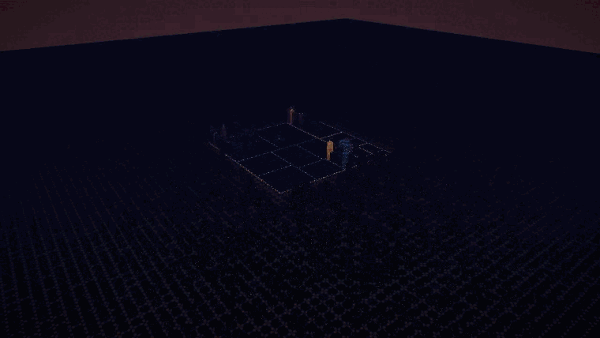

# Git-Cinematic

**Fly through your git history as a living 3D city.**

Every file is a building. Directories are districts, with boulevards, traffic and street lamps
between them. Buildings grow and shrink as lines are added and deleted, files with a run of bug
fixes catch fire and throw off embers, and the files everything else changes with glow like calm
monoliths. Fly over it like an open-world game, or press play and the whole history of the
repository replays as a film, chapter by chapter.

[**Open the live demo →**](https://git-cinematic.shantpaulchanditala.workers.dev)



[](https://github.com/sharkkyyy10/git-cinematic/actions/workflows/ci.yml)

## Quickstart

You need Node.js 20 or newer and git. Run it straight from GitHub, nothing to install:

```bash
cd path/to/any/repo
npx github:sharkkyyy10/git-cinematic#cli analyze   # writes .cinematic/city.bin
npx github:sharkkyyy10/git-cinematic#cli view      # opens the city in your browser
npx github:sharkkyyy10/git-cinematic#cli report -o report.md   # the written report
```

The `cli` branch holds the ready-built package, so the first run downloads about 450 KB and
starts in seconds. Pass a path to film another repository:
`npx github:sharkkyyy10/git-cinematic#cli analyze ../my-project`.

### From source

```bash
git clone https://github.com/sharkkyyy10/git-cinematic.git
cd git-cinematic
npm ci
npm run build
node packages/cli/dist/main.js analyze
node packages/cli/dist/main.js view
```

`analyze` prints a one-screen summary with the top hotspots and writes `.cinematic/city.bin`.
`view` serves the viewer on `127.0.0.1` and opens your browser. Press <kbd>Ctrl</kbd>+<kbd>C</kbd> to stop.

### Share a city on the web

Commit the city file to a public GitHub repository and open
`https://git-cinematic.shantpaulchanditala.workers.dev/gh/<owner>/<repo>`. The viewer reads
`.cinematic/city.bin` from the repository's default branch, so the link always shows the latest
city you committed. You can also drop any `city.bin` onto the page, or use **Open**.

## What it tells you

Git-Cinematic is not only a film. Every city comes with an analysis of the codebase:

- **A health score** from 0 to 100 with a grade, built from four signals you can read: how much
  of the work is bug fixing, how much code only one person knows, how much is on fire right now,
  and how much sits in very large files.
- **Findings in plain language**, most severe first, each with why it matters and what to do:
  hotspots (big files that never stop changing), files on fire, bug-prone files, knowledge silos
  (busy files only one person has touched), change magnets (files that drag others along) and
  dormant giants (large files nobody has touched in a long time). Click a file to fly to it, or
  light up every match on the map.
- **Lenses** that recolour the whole city to answer one question at a time: **Risk**, **Bugs**,
  **Silos**, **Coupling** and **Age**. Press <kbd>1</kbd> to <kbd>6</kbd>.
- **A guide** (<kbd>?</kbd>) that explains every colour, with live counts and a button to show
  the matching buildings.
- **A Markdown report** to hand to your team or a client: **Download report** in the viewer, or
  `git-cinematic report` in a terminal (handy in CI).

Who it is for: tech leads deciding what to refactor first, engineering managers explaining tech debt
to people who do not read code, consultants and acquirers sizing up an unfamiliar codebase, and new
hires learning the shape of a system.

## Use it in CI: a code-health gate for every pull request

Add one step to a workflow. It scores the branch, compares it with the target branch, writes the
report into the job summary, annotates hotspots, and fails the build when health slips:

```yaml
# .github/workflows/code-health.yml
name: code health
on: [pull_request]
jobs:
  health:
    runs-on: ubuntu-latest
    steps:
      - uses: actions/checkout@v4
        with:
          fetch-depth: 0          # the history is the input
      - uses: actions/setup-node@v4
        with:
          node-version: 20
      - uses: sharkkyyy10/git-cinematic@main
        with:
          min-health: "60"                       # fail below 60
          baseline: origin/${{ github.base_ref }} # compare with the target branch
          max-drop: "5"                          # fail if health drops more than 5 points
          max-new-hotspots: "0"                  # fail if the change creates a hotspot
```

The action outputs `health`, `grade` and `passed` for later steps. This repository runs it on
itself in [`.github/workflows/health.yml`](.github/workflows/health.yml).

The same gate works in any CI from the command line:

```bash
npx github:sharkkyyy10/git-cinematic#cli analyze -o now.bin
git worktree add ../base origin/main && npx github:sharkkyyy10/git-cinematic#cli analyze ../base -o base.bin
npx github:sharkkyyy10/git-cinematic#cli check now.bin --baseline base.bin --min-health 60 --max-drop 5
```

### A health badge for your README

```bash
npx github:sharkkyyy10/git-cinematic#cli badge -o .cinematic/health.svg
```

Commit the SVG and add `` to your README. It is generated
locally, so it works for private repositories too.

### What is left out

Lock files, changelogs, generated files (minified, protobuf, snapshots) and vendored folders
(`node_modules`, `vendor`, `dist`, …) change all the time without anyone working on them. They stay in
the city, but they are never hotspots, findings or part of the health score.

## What you are looking at

| In the city | Comes from |
|---|---|
| Building height | Lines in the file at that moment (log scale) |
| Building footprint | The largest the file ever grew |
| Fire (inferno glow, flickering above 60%) | Recent bug-fix commits touching the file, decaying over time |
| Lit windows | Co-change centrality: how often the file changes together with others |
| Cool blue rim | Calm monoliths: highly central files that are not on fire |
| District plates | Directories, nested by depth; the biggest are named on the map |
| Boulevards and side streets | The gaps between directories, with traffic and street lamps |
| Red aviation beacons | The tallest files at this moment in history |
| Rising embers | Files burning hottest with recent fixes |
| Coloured chapters on the timeline | Eras: steady build, expansion, fix wave, cleanup |

The side panel for a file shows its lines, churn, fixes, authors, centrality and hotspot rank.
A **hotspot** is a file that is both large and frequently changed: rank-percentile of churn
times rank-percentile of lines.

### Controls

| Key or control | Action |
|---|---|
| <kbd>Space</kbd> | Play or pause the replay |
| <kbd>←</kbd> / <kbd>→</kbd> | Step one time bucket |
| <kbd>/</kbd> | Search files (fuzzy); <kbd>Enter</kbd> flies to the match |
| <kbd>1</kbd>–<kbd>6</kbd> | Cinematic, Risk, Bugs, Silos, Coupling and Age lenses |
| <kbd>I</kbd> / <kbd>?</kbd> | Insights (health and findings) / the colour guide |
| <kbd>T</kbd> | Camera tour of the top five hotspots |
| <kbd>Esc</kbd> | Clear a highlight; close the panel, the search or the tour |
| <kbd>W</kbd> <kbd>A</kbd> <kbd>S</kbd> <kbd>D</kbd> | Fly over the city (hold <kbd>Shift</kbd> to go faster) |
| <kbd>Q</kbd> / <kbd>E</kbd> | Turn left or right |
| Drag, scroll | Orbit and zoom |
| Minimap | Rotates with the camera, shows files on fire; click to travel there |
| Click a building | File details, with **Fly to** |
| **Record** | Records a full replay plus the tour and downloads a WebM video |
| **Share** | Copies the link to this city |

Reduced-motion settings turn off the fly-in, the fire flicker, the embers and the automatic tour.

## How it works

1. **Ingest.** One `git log --numstat -z` process is streamed and parsed incrementally. Renames
   keep a file's identity, so its history follows it. Line counts at `HEAD` come from a single
   `git cat-file --batch`.
2. **Metrics.** Per file: lines, peak lines, churn, fix commits, authors, and PageRank on the
   co-change graph. Commits that touch more than 50 files (reformats, vendor drops, bulk renames)
   are left out of churn, fixes and coupling.
3. **Time.** History is cut into 8 to 128 equal buckets. Each bucket stores every file's height
   and its decaying fix heat.
4. **Eras.** Commits per bucket are segmented on the mean into at most eight chapters, each
   classified and titled after the directory with the most churn, such as `Fix wave · packages/auth`.
5. **Layout.** A squarified treemap over every path that ever existed, so buildings never move
   during the replay.
6. **Render.** One instanced mesh draws the whole city. The history is uploaded once as a GPU
   texture, and the vertex shader interpolates between buckets, so scrubbing the timeline
   changes a single number. Traffic, beacons and embers read the same texture, so they follow
   the replay too. The sky, the procedural outskirts and the traffic are all drawn by shaders,
   and nothing in the world is random between visits.

The whole pipeline is deterministic. The same repository at the same commit produces a
byte-identical city file. On a laptop, a synthetic repository with 50,000 commits and 10,000 files
is analysed in about 4 seconds.

The binary format is documented in [docs/CITY_FORMAT.md](docs/CITY_FORMAT.md), and the full
design is in [docs/BUILD_PLAN.md](docs/BUILD_PLAN.md).

## CLI reference

```text
git-cinematic analyze [repo=.] [-o .cinematic/city.bin] [--since 2023-01-01] [--max-commits 50000] [--max-files 20000]
git-cinematic view    [city=.cinematic/city.bin] [--port 4173] [--no-open]
git-cinematic report  [city=.cinematic/city.bin] [-o report.md] [--baseline old.bin]
git-cinematic check   [city=.cinematic/city.bin] [--min-health 60] [--baseline old.bin] [--max-drop 5] [--max-new-hotspots 0] [--github]
git-cinematic badge   [city=.cinematic/city.bin] [-o .cinematic/health.svg] [--label "code health"]
git-cinematic --version | --help
```

- `--since` analyses commits after a date; `--max-commits` keeps the newest *n*.
- `--max-files` keeps the largest files and folds the rest into one `(other)` building per directory.
- `analyze` also prints the health score and the main findings.
- `report` prints the Markdown report, or writes it with `-o`. With `--baseline` it adds what changed
  since then: the health delta, new and resolved hotspots, newly burning files and what grew most.
- `check` is the quality gate: it exits with 1 when a rule fails. `--github` (automatic inside
  GitHub Actions) adds error and hotspot annotations, the job summary and step outputs.
- `badge` writes an SVG health badge.
- `analyze`, `report`, `check` and `badge` exit with 1 when there is nothing to read (not a git repository, no commits, no
  or a corrupt city file), and with 2 on bad arguments.

## Privacy

- **Your code never leaves your machine.** `analyze` runs locally and uploads nothing.
- A city file contains file paths, author display names, commit counts and scores. It never contains
  file contents, commit messages or email addresses.
- `view` listens on `127.0.0.1` only.
- The hosted viewer is a static site. It loads a city only from this site, from an `https://` URL
  you give it, or from a file you open, which never leaves your browser.

## Development

```bash
npm ci
npx playwright install chromium
npm run check   # lint, typecheck, unit tests, build, browser tests
npm run demo    # regenerate the seeded demo city (packages/viewer/public/demo/city.bin)
npm run smoke:pack   # pack the CLI, install it into a temp dir and run it through npx
scripts/publish-cli-branch.sh   # after npm run build: publish the packed CLI to the cli branch
```

The workspace has three packages: [`packages/core`](packages/core) (ingest, metrics, eras, layout
and the city format), [`packages/cli`](packages/cli) and [`packages/viewer`](packages/viewer)
(Vite and three.js). The site is deployed to Cloudflare Workers Static Assets with
[`scripts/deploy.sh`](scripts/deploy.sh), which needs `CLOUDFLARE_API_TOKEN` and `CLOUDFLARE_ACCOUNT_ID`
in the environment. `node scripts/hero.mjs` recreates the animation above using the viewer's own
Record button.

## License

[MIT](LICENSE)
